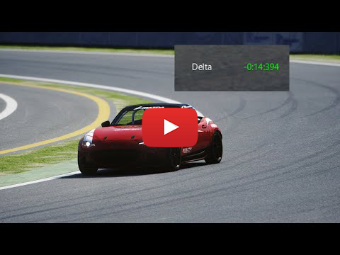

# Track Sectors - Assetto Corsa App

A comprehensive sector timing app for Assetto Corsa that helps drivers analyze their performance by dividing tracks into customizable sectors. Identify your strengths and weaknesses to improve lap times with precision timing data.

## 🎯 Features

- **Custom Sector Creation** - Define unlimited sectors on any track with AI line support
- **Multi-Layout Support** - Separate configurations for different track layouts
- **Real-Time Analysis** - Live sector timing with theoretical best lap calculations
- **Session Compatibility** - Works in Practice, Qualifying, Hotlap, and Race sessions
- **Data Persistence** - Automatic backup system with 10-session history
- **Performance Tracking** - Store and compare times across different cars and sessions

## 📋 Prerequisites

- Assetto Corsa with Custom Shaders Patch (CSP) v2.2+
- Track with implemented AI line
- Active game session (not replay mode)

## ⚡ Installation

1. Download from [RaceDepartment](https://www.racedepartment.com/downloads/track-sectors-divide-the-track-in-sections.43904/)
2. Extract to your Assetto Corsa apps folder
3. Enable the app in Content Manager or in-game

## 🚀 Usage

### Initial Setup

1. Select desired number of sectors
2. Drive to each sector endpoint and press the corresponding button
3. Follow on-screen instructions to complete configuration
4. Start timing your sessions

### Session Analysis

- View real-time sector times during driving
- Compare current performance against personal bests
- Access theoretical best lap time calculations
- Monitor sector-by-sector improvements

## 📸 Demo

## 🎮 Supported Sessions

- **Practice** - Single and multiplayer
- **Qualifying** - Single and multiplayer
- **Hotlap** - Time attack sessions
- **Race** - Full race weekends

## 📊 Key Features

- Intuitive UI with visual feedback for invalid operations
- Automatic data backup and recovery system
- Modular architecture built with OOP principles
- Customizable opacity and layout options
- Orange highlighting for current active sector
- Audio notifications for new best times

## 📚 Documentation

- [User Manual](https://github.com/RuseCristian/Track-Sectors-Assetto-Corsa-App/files/10046798/Track.Sectors.User.Manual.pdf)
- [Technical Documentation](https://github.com/RuseCristian/Track-Sectors-Assetto-Corsa-App/files/10046803/Technical.Explainations.pdf)

## 🔄 Latest Updates (v1.4.2)

- Enhanced UI with descriptive error messages
- Improved session management and pit detection
- Complete rewrite for better modularity and debugging
- Fixed dictionary crashes and timing recording bugs
- Robust replay detection and session validation

## 🤝 Contributors

- **Stereo** - Button function modularity
- **Nache** - Logistics and problem solving
- **LeBluem** - Third-party library conflict resolution

## 📄 License

Created by Ruse Cristian

---

  <strong>🏁 Perfect your racing lines, one sector at a time</strong>

